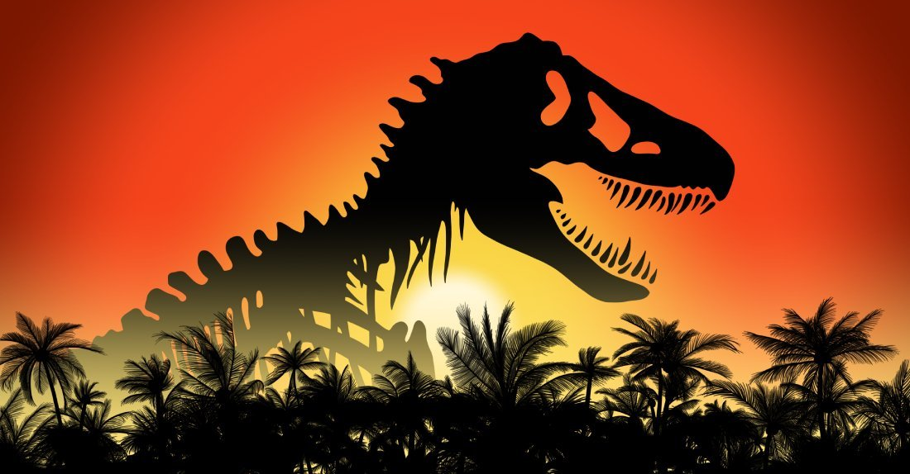

# 🦕 dino.library

<div align="center">



**Um museu digital editorial e arquivo aberto de vida pré-histórica — mais de 1.500 espécimes catalogados, cartografia de sítios fósseis, literatura acadêmica com identificadores DOI, expedições temáticas e cronologia geológica do Mesozoico.**

[Explorar o Acervo Online](https://dino-library.vercel.app)

*Disponível integralmente em Português (BR), English e Español.*

---

</div>

## 🏛️ A Filosofia do Museu

O **dino.library** foi concebido não como um catálogo convencional de dados, mas como uma **instituição viva de história natural e investigação científica**. Inspirado nos arquivos solenes do *Natural History Museum* de Londres, do *American Museum of Natural History* de Nova York e do *Museu Nacional da UFRJ*, a aplicação combina o rigor da taxonomia biológica moderna com uma experiência editorial cinematográfica, arejada e visualmente contemplativa.

Cada sala foi projetada como uma ala de exposição curada: placas murais explicativas, tipografia humanista e grotesca, detalhes em jade fóssil e âmbar mineralizado, enquadramento de paleoarte em proporção áurea e ausência completa de ruído visual desnecessário.

---

## 🧭 As Salas de Exposição & Ferramentas de Investigação

O acervo é organizado em torno de salas temáticas que permitem ao visitante transitar entre a observação anatômica minuciosa, a leitura de artigos científicos primários e a compreensão dos ecossistemas pretéritos:

```
dino.library
│
├── [Sala 01] Entrada & Placas Murais (Página Principal)
│   ├── Fóssil em Destaque & Vitrine do Dia
│   ├── Os Cinco Instrumentos de Investigação
│   └── Despachos Recentes de Campo & Revisão por Pares
│
├── [Sala 02] Coleção & Catálogo Taxonômico (1.541 Espécimes)
│   ├── Sistema de Filtragem Multidimensional (Período, Dieta, Continente, Dimensões)
│   ├── Vitrines em Grade Panorâmica Ajustável (2 a 6 Colunas)
│   └── Dossiê Individual da Espécie (Etimologia, Anatomia, Biomecânica e Ecologia)
│
├── [Sala 03] Expedições & Rotas Temáticas (Curadoria de Clados)
│   ├── Gigantes do Gondwana & Laurásia (Saurópodes e Titanossauros)
│   ├── Predadores Ápice & Biomecânica de Mordida (Terópodes)
│   ├── Fauna Fóssil Brasileira (Formações Crato, Santana e Santa Maria)
│   ├── Tanques Vivos & Dinossauros Encouraçados (Tireóforos)
│   └── A Origem das Aves & A Revolução das Penas (Maniraptores)
│
├── [Sala 04] Cartografia Fóssil & Paleogeografia Global
│   ├── Mapeamento Geoespacial Interativo de Sítios Paleontológicos
│   └── Estratificação por Clado Filogenético e Época Geológica
│
├── [Sala 05] Linha do Tempo & Estratigrafia do Mesozoico
│   ├── Escala de Tempo Geológico (Triássico, Jurássico e Cretáceo)
│   └── História da Paleontologia (De Mary Anning às Expedições do Deserto de Gobi)
│
├── [Sala 06] Escola & Laboratório de Fixação
│   ├── Sessões de Quiz Científico por Nível de Dificuldade
│   └── Dinâmica de Bônus por Velocidade e Acervo Pessoal de Conquistas
│
├── [Sala 07] Feed Científico & Literatura Acadêmica Verificada
│   ├── Artigos e Monografias Revisados por Pares (*Nature*, *Science*, *Royal Society*)
│   ├── Integração Viva com a API Científica Global OpenAlex
│   ├── Metadados Formais com DOI Verificado e Link Canônico
│   └── Exportação de Citação Instantânea em APA 7ª Edição e BibTeX
│
└── [Sala 08] Glossário de Termos Paleontológicos
    └── Léxico Multilíngue (Holótipo, Cladística, Estratigrafia, Tafonomia, Ontogenia)
```

---

### 1. Sala do Catálogo (O Arquivo de 1.541 Espécies)
A sala central reúne registros de mais de mil e quinhentos gêneros de dinossauros validados pela literatura paleontológica. 
- **Filtros Parametrizados na URL**: Selecione simultaneamente períodos geológicos (do Triássico Inferior ao Maastrichtiano final), grupos tróficos (carnívoros, herbívoros, piscívoros e onívoros), bacias fossilíferas de todos os continentes e réguas interativas de comprimento (0 a 50 metros) e altura.
- **Persistência de Pesquisa**: Cada combinação de filtros reflete diretamente nos parâmetros da URL, permitindo salvar, compartilhar ou revisitar conjuntos específicos de espécimes.
- **Flexibilidade de Grade**: Escolha entre grades de 2 até 6 colunas, aproveitando telas panorâmicas com enquadramentos de paleoarte que mantêm a integridade anatômica dos animais.

---

### 2. O Dossiê Individual do Espécime
Ao selecionar qualquer exemplar, o visitante acessa o arquivo completo do organismo:
- **Etimologia & Significado**: A raiz linguística grega e latina que batizou o táxon.
- **Índice Biométrico**: Dimensões calculadas de massa corporal, comprimento e altura ao quadril.
- **Notas de Comportamento & Paleoambiente**: Nicho trófico ocupado, modo de locomoção (bípede estrito, quadrúpede facultativo) e quociente de encefalização estimado.
- **Coleção Pessoal**: Salve espécimes favoritos com um clique para rápido acesso no seu perfil de pesquisador.

---

### 3. Rotas Temáticas & Curadoria Paleobiológica
Para quem busca trilhas de aprendizado contextualizadas, a seção de Descobertas oferece itinerários organizados por temas evolutivos:
- **Os Maiores Animais Terrestres**: A evolução do gigantismo sauropodomorfo (*Patagotitan*, *Argentinosaurus*, *Brachiosaurus*).
- **Caçadores Pré-Históricos**: A corrida armamentista entre terópodes carcarodontossaurídeos e tiranossauróideos.
- **A Paleontologia Brasileira**: Fósseis emblemáticos das bacias do Araripe e do Paraná (*Oxalaia*, *Irritator*, *Ubirajara*, *Buriolestes*).
- **Armaduras e Espinhos**: A evolução defensiva dos estegossauros e anquilossauros.
- **Dinossauros Alados & Transição para as Aves**: Fósseis murchos de penas preservados em folhelhos da China (*Sinosauropteryx*, *Microraptor*).

---

### 4. Feed Científico & Literatura com DOIs Verificados
Diferente de agregadores de notícias genéricas, o **dino.library** possui um módulo dedicado à pesquisa primária de artigos científicos revisados por pares:
- **Periódicos de Alto Impacto**: Cobertura de marcos das revistas *Nature*, *Science*, *Cretaceous Research*, *Current Biology* e *Proceedings of the Royal Society*.
- **Identificadores DOI & Acesso Canônico**: Cada artigo conta com DOI certificado (`10.xxxx/...`) que direciona para a publicação oficial do periódico com acesso ao texto integral e PDF.
- **Dossiê Bibliográfico**: Copie a citação acadêmica formatada em **APA 7ª Edição** ou o registro **BibTeX** pronto para uso no LaTeX / Zotero / Mendeley com um único clique.
- **Feed Aberto em Tempo Real (OpenAlex)**: Conexão direta com a base aberta de metadados científicos mundiais OpenAlex, trazendo publicações paleontológicas recentes e indexadas por pesquisadores internacionais.

---

### 5. Cartografia Paleogeográfica & Mapeamento Fóssil
Uma representação cartográfica interativa que plota as localidades de achados fósseis em um mapa global de tema escuro:
- Filtre sítios por clado fóssil (Terópodes, Saurópodes, Ceratopsianos, Ornitópodes, Tireóforos).
- Explore a distribuição de fósseis nos antigos continentes de Pangeia, Gondwana e Laurásia.
- Acesso direto do marcador cartográfico para a ficha técnica do espécime correspondente.

---

### 6. Linha do Tempo Estratigráfica & História das Descobertas
A cronologia da vida pré-histórica dividida em duas perspectivas complementares:
- **A Escala Mesozoica**: Do surgimento dos primeiros arcossauros no Triássico, passando pela era de ouro dos saurópodes no Jurássico, até a extinção do limite K-Pg no fim do Cretáceo.
- **A História da Paleontologia Humana**: A cronologia dos naturalistas e pesquisadores que desvendaram os fósseis — de Mary Anning em Lyme Regis e Sir Richard Owen cunhando o termo *Dinosauria*, às expedições de Roy Chapman Andrews no Deserto de Gobi e descobertas contemporâneas no Brasil e na Patagônia.

---

### 7. A Escola de Paleontologia (Quizzes & Fixação)
Um ambiente lúdico desenhado para testar e expandir os conhecimentos de entusiastas e estudantes:
- Desafios cronometrados com três graus de rigor (Fácil, Médio e Avançado).
- Perguntas multilíngues cobrindo fisiologia, tafonomia, descobertas históricas e períodos geológicos.
- Cálculo de pontuação com bônus de velocidade e registro de progresso no perfil do usuário.

---

### 8. Glossário Terminológico Especializado
Um vocabulário de referência para compreender o jargão científico empregado por paleontólogos e biólogos evolutivos:
- Mais de 20 verbetes traduzidos e comentados (ex.: *Holótipo*, *Cladística*, *Estratigrafia*, *Ontogenia*, *Tafonomia*, *Dimorfismo Sexual*, *Lagerstätte*).
- Exemplos reais aplicados a fósseis conhecidos e navegação cruzada entre conceitos relacionados.

---

## 🎨 Arquitetura de Design & Usabilidade

- **Espaço Amplo de Respiro**: O layout emprega um container panorâmico de até **1.720px**, aproveitando telas modernas de alta resolução com elegância e proporções generosas.
- **Cores & Iluminação**: Paleta escura baseada em ardósia fóssil, realçada por toques de verde jade mineralizado (`#5eead4` / `hsl(158, 86%, 72%)`) e tipografia legível e contrastante.
- **Resiliência e Funcionamento Local**: O sistema foi estruturado para manter pleno funcionamento das salas de acervo, catálogo, linha do tempo, glossário e literatura mesmo em ambientes sem conectividade com serviços de nuvem externos.
- **Acessibilidade & Fluidez**: Animações suaves respeitando preferências do sistema operacional (`prefers-reduced-motion`), componentes com foco visual acessível e atalhos rápidos de navegação.

---

## 📜 Créditos & Dados Científicos

- **Base Taxonômica de Gêneros**: Base adaptada e higienizada a partir do *Dinosaur Genera Dataset* e do *The Paleobiology Database* (PBDB).
- **Literatura e Artigos Científicos**: Metadados científicos catalogados via *OpenAlex Open Scientific Graph* e repositórios oficiais com licença aberta das publicações originais (*Nature Portfolio*, *Springer Nature*, *The Royal Society*, *Cell Press / Current Biology*).
- **Cartografia**: Dados cartográficos sob licença © OpenStreetMap e estilização CARTO.
- **Paleoartes e Ilustrações**: Gabriel Ugueto, Paleoart Archive, Wikimedia Commons (CC BY-SA 4.0 / CC BY 4.0) e acervos abertos de museus de história natural.

---

## ✍️ Autoria & Realização

**Enzo Esmeraldo** — [GitHub](https://github.com/ensinho) · [LinkedIn](https://www.linkedin.com/in/enzoesmeraldo)

*dino.library · Uma homenagem à história profunda do planeta Terra e à ciência paleontológica.*
