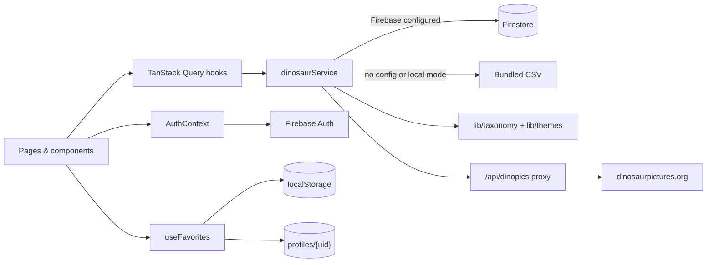

# 🦕 Dino Library

<div align="center">


**An editorial, museum-inspired library of prehistoric life — 1,500+ species, a fossil map, curated themes, quizzes and paleontology news, in three languages.**

[](https://github.com/ensinho/dino-library/actions/workflows/ci.yml)
[](https://react.dev/)
[](https://www.typescriptlang.org/)
[](https://firebase.google.com/)
[](./LICENSE)

[Live demo](https://dino-library.vercel.app) · [Report a bug](https://github.com/ensinho/dino-library/issues)

</div>

---

## Features

| Room | What it does |
| --- | --- |
| **Catalogue** | 1,541 species with full-text search, period / diet / region filters, size ranges and sorting. Filters live in the URL, so every result set is shareable and survives back/forward. |
| **Species file** | Fact file, anatomy, ecology and discovery tabs, an image gallery from [dinosaurpictures.org](https://dinosaurpictures.org), and **related species** ranked by shared period, diet and region. |
| **Discover** | Curated themes (giants, apex predators, Brazil, armoured, recent finds, feathered) with deep links into the catalogue. |
| **Fossil map** | Every specimen plotted from its fossil locality on a dark Leaflet basemap, filterable by clade and period, with links to each species file. |
| **Timeline** | Archaeological discoveries and the major geological events of the Mesozoic. |
| **Schoolroom** | Timed quizzes by difficulty with streak and speed bonuses; results accumulate on your profile. |
| **Profile** | Your **collection** of saved species, quiz statistics and achievements. |
| **News** | Long-form paleontology articles, localised. |

Everything is available in **English, Português (BR) and Español**.

## Tech stack

- **React 18 + TypeScript + Vite**, route-level code splitting with `React.lazy`
- **TanStack Query** for data fetching and caching
- **Tailwind CSS + Radix UI** (shadcn/ui primitives) on a custom editorial design system
- **Firebase Auth + Cloud Firestore**
- **Leaflet / react-leaflet** with canvas-rendered markers
- **i18next** with lazy-loaded locale files
- **Vitest** for unit tests, **GitHub Actions** for CI, **Vercel** for hosting

## Architecture



A few decisions worth calling out:

- **Read once, compute in memory.** The species collection is ~1.5k documents, so it is fetched once per session and every filter, sort, page, stat and "related species" lookup runs in memory. That replaced a 1,000-document Firestore read on *every* filter change.
- **Normalise the data, not the UI.** The source dataset is noisy — 70+ spellings of geological periods, continents mixed with countries, qualifiers like "Carnivore (disputed)". [`src/lib/taxonomy.ts`](./src/lib/taxonomy.ts) maps those to clean buckets and coordinates, and is covered by tests that run against the real CSV (≥ 97 % of species get a period, region and map position).
- **Works without a backend.** With no Firebase config the app reads the bundled CSV (lazy-loaded), so a fresh clone runs with `npm i && npm run dev`. Auth, quizzes and the timeline need Firebase.
- **Favourites for everyone.** Guests keep a collection in `localStorage`; on sign-in it is merged into their Firestore profile and synced from then on.
- **Atomic quiz stats.** Results are folded into the profile in a Firestore transaction (best, latest, average, count), so concurrent sessions can't overwrite each other.

## Getting started

```bash
git clone https://github.com/ensinho/dino-library.git
cd dino-library
npm install
npm run dev            # http://localhost:8080
```

That's enough to browse the catalogue, Discover and the map using the bundled dataset. To enable accounts, quizzes and the timeline, copy the env template and fill in a Firebase web app config:

```bash
cp .env.example .env
```

### Firestore collections

| Collection | Contents | Suggested rule |
| --- | --- | --- |
| `dinosaur_species2` | One document per species (`row_index` as id) | public read |
| `quiz_questions` | Questions with `difficulty` and optional per-language fields | public read |
| `archaeological_discoveries` | Timeline entries ordered by `discovery_date` | public read |
| `profiles/{uid}` | Display name, bio, `quiz_scores`, `favorites` | read/write only when `request.auth.uid == uid` |

`npm run enrich:images` backfills `image_url` / `image_urls` in Firestore from dinosaurpictures.org using a Firebase Admin service account (`GOOGLE_APPLICATION_CREDENTIALS`).

## Scripts

```bash
npm run dev          # Vite dev server
npm run build        # Production build
npm run preview      # Serve the production build
npm run lint         # ESLint
npm run typecheck    # TypeScript, no emit
npm test             # Vitest unit tests
```

## Project structure

```
src/
├── components/     # SpeciesCard, FavoriteButton, PageState, layout, ui/ (shadcn)
├── contexts/       # AuthContext
├── hooks/          # useDinosaurs, useFavorites, useDinoLabels, usePageTitle…
├── lib/            # taxonomy, themes, quiz scoring, config, i18n
├── pages/          # One file per route, lazy-loaded
└── services/       # Firestore, auth, profile, quiz, news, image enrichment
api/dinopics/       # Vercel functions proxying dinosaurpictures.org (CORS)
public/locales/     # en, pt-BR, es
scripts/            # Dataset CSV and the image enrichment script
```

## Data & credits

- Species data: [Dinosaur Genera Dataset](https://www.kaggle.com/datasets/canozensoy/dinosaur-genera-dataset) (Kaggle)
- Images: [dinosaurpictures.org](https://dinosaurpictures.org) — each image links back to its source
- Basemap: © OpenStreetMap contributors © CARTO

Map positions are approximate: each specimen is placed at the region named in its record and slightly offset so nearby finds stay visible.

## Roadmap

- [x] Favourites / personal collection
- [x] Offline-capable dataset fallback
- [ ] Species comparison view
- [ ] Localised glossary and species descriptions
- [ ] PWA with offline caching
- [ ] Enable TypeScript `strict` mode

## License

[MIT](./LICENSE) © Enzo Esmeraldo

## Author

**Enzo Esmeraldo** — [GitHub](https://github.com/ensinho) · [LinkedIn](https://www.linkedin.com/in/enzoesmeraldo)
